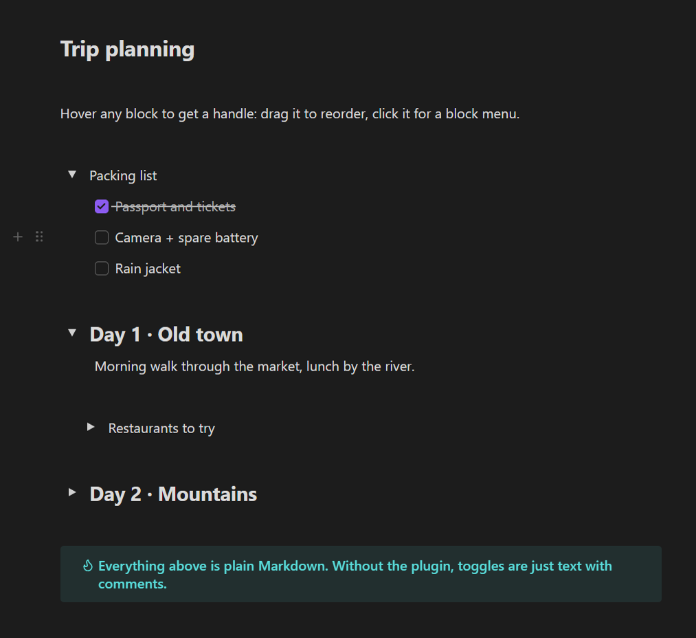

# Editor Enhancer

**Notion-style editing for Obsidian's Live Preview: drag blocks around, fold sections into toggle lists, and stop fighting the editor.**



## Is this for you?

- You moved from **Notion** and miss grabbing a paragraph by its ⋮⋮ handle and dropping it somewhere else.
- Your notes get long and you want **toggle lists**: a title you can click to hide or show everything under it, nested as deep as you like.
- You are tired of cut-and-paste just to move a list item, a callout or an image three lines up.
- You right-click a word and Obsidian selects the whole line. You wish it didn't.
- You jump between notes and lose your scroll position every time.

## What you get

| Feature | What it does |
|---|---|
| **Block handles** | Hover any block (paragraph, heading, list item, callout, code block, image, embed) to see ⋮⋮ and +. Drag ⋮⋮ to move the block; click it for a menu: duplicate, cut, delete, turn into toggle list. + inserts an empty line below. |
| **Toggle lists** | Click ▸ to fold. Titles can be plain text or headings, toggles can be nested, Enter / Backspace behave like in Notion. |
| **List markers as one unit** | The `-`, `1.` or `- [ ]` prefix of a list line acts like one character: the caret never lands inside it and one Backspace removes it. |
| **Right-click that behaves** | Right-click keeps your cursor where it is; related menu items are grouped together. |
| **Scroll memory** | Come back to a note and you are where you left off. |
| **Tables on mobile** | Tap a link inside a table and it opens, instead of starting to edit the cell. |

Every feature group has its own switch in **Settings → Editor Enhancer**, plus spacing and icon size controls.

## Your notes stay plain Markdown

A toggle list is stored as an ordinary line with an invisible comment:

```markdown
Packing list %% nsb-toggle {"id":"tgl-pack","open":true,"v":2} %%
- Passport
- Camera
%% /nsb-toggle %%
```

Uninstall the plugin, open the note in another app, or sync it to a phone without the plugin: you still see the title and the list. Nothing is locked in.

## Quick start

1. Install and enable the plugin.
2. Open any note in **Live Preview** (the default editing mode).
3. Move the mouse over a paragraph: drag the ⋮⋮ handle up or down.
4. Click ⋮⋮ → **Toggle list** to turn a line into a foldable title.

## Works on

Windows, macOS, Linux, iPhone / iPad and Android. Block dragging is built for a mouse or trackpad. Toggle lists, list markers, scroll memory and table links work the same on phones and tablets.

## Works well with

All optional. Each plugin works on its own.

- [Expiring Blocks](https://github.com/Paipa03/obsidian-expiring-blocks): toggle lists that clean themselves up after a few days.
- [Paipa Gallery](https://github.com/Paipa03/obsidian-paipa-gallery): image and video galleries you can drag like any block.
- [Section Blocks](https://github.com/Paipa03/obsidian-section-blocks) and [Web Bookmark](https://github.com/Paipa03/obsidian-web-bookmark) join the same block menu.

## Notes

- Interface in English and Chinese: follows Obsidian's language by default, or pick one under the plugin's **Language** setting.
- Reading view is not changed. Everything happens in Live Preview.

## Install

**Settings → Community plugins → Browse**, search **Editor Enhancer**, then Install and Enable.

## License

MIT
